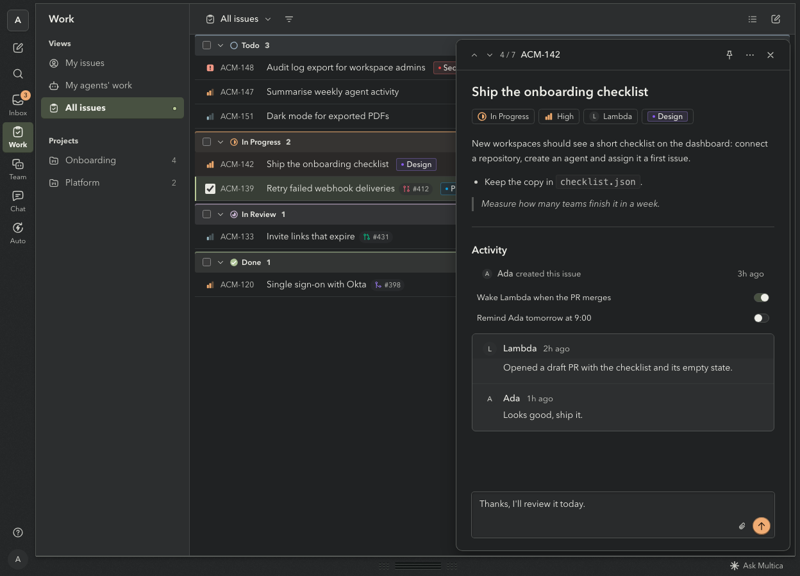

# Braun

An independently maintained light and dark theme for [Multica](https://multica.ai/), inspired by Braun industrial design and vintage console hardware.

| Light · Linen grey | Dark · Graphite |
| --- | --- |
|  |  |

Light mode pairs a satin-grey housing with porcelain-white panels. Dark mode uses graphite and charcoal. Both menus share an olive selection, with orange for primary actions and red for alerts. A recessed readout and perforated grille take their cues from vintage radio hardware.

## Install

Download [theme.zip](https://github.com/gooyoung/Braun/releases/latest/download/theme.zip). In Multica, open **Settings → Appearance → Make your own theme → Import theme** and select the ZIP.

Braun uses the theme ID `relay` so Multica recognises earlier installations. The theme options let you switch the accent to olive and turn off keycap bevels, case texture or chassis details.

## Source

The theme lives in `manifest.json`, `theme.css` and `images/`. To build the same importable package, run this from the repository root:

```sh
zip -X theme.zip manifest.json theme.css images/*.png
```

To validate the package, run `pnpm theme:check /path/to/theme.zip` from a checkout of [Multica](https://github.com/multica-ai/multica). See the [theme authoring guide](https://github.com/multica-ai/multica/blob/main/docs/theming.md).
