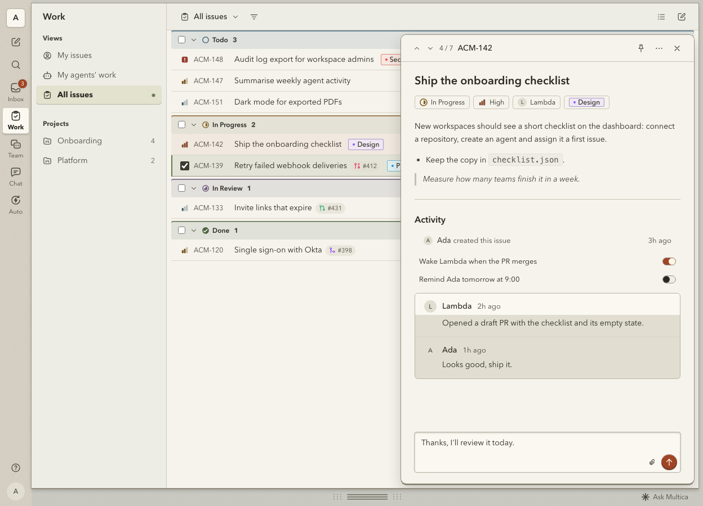

# Relay 灰壳终端

A light and dark theme for [Multica](https://multica.ai/), inspired by two-tone mechanical keyboards and vintage console hardware.

| Light · Linen grey | Dark · Graphite |
| --- | --- |
|  |  |

Light mode pairs a linen-grey rail and ivory keycaps with muted burnt-orange controls. Dark mode pairs graphite with a smoked-green issue title and amber indicators. A matte navigation panel, a perforated grille and colour-coded workflow lanes take their cues from Braun radios and Bauhaus graphics.

## Install

Download [theme.zip](https://github.com/gooyoung/multica-theme-relay/releases/latest/download/theme.zip). In Multica, open **Settings → Appearance → Make your own theme → Import theme** and select the ZIP.

The theme options let you switch the accent to olive and turn off keycap bevels, case texture or chassis details.

## Source

The theme lives in `manifest.json`, `theme.css` and `images/`. To build the same importable package, run this from the repository root:

```sh
zip -X theme.zip manifest.json theme.css images/*.png
```

To validate the package, run `pnpm theme:check /path/to/theme.zip` from a checkout of [Multica](https://github.com/multica-ai/multica). See the [theme authoring guide](https://github.com/multica-ai/multica/blob/main/docs/theming.md).
