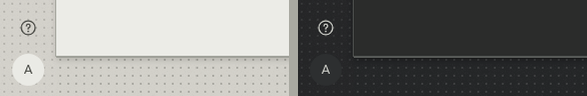

# Braun

An independent, Braun-inspired console theme that gives Multica boards the feel of a 1970s precision instrument.

[简体中文](README.zh-CN.md) · [Download theme.zip](https://github.com/gooyoung/multica-theme-braun/releases/latest/download/theme.zip)

| Light · Linen grey and porcelain | Dark · Graphite and charcoal |
| --- | --- |
|  |  |

## Design

The layout follows the front panel of a vintage radio. The outer frame reads as a chassis, the navigation as a control panel, and the main canvas as the work surface. Fine perforations cover the exposed frame, from the navigation rail to the bottom edge. The flat panels and aligned controls leave room for the board and its tasks.

Light mode pairs linen grey with a warm porcelain canvas. Dark mode carries the same hierarchy into graphite and charcoal. Small graphite keycaps and softly raised buttons borrow their feel from the Braun ET 66 calculator.



## Palette

Neutrals define the structure so the few colour accents carry a clear purpose.

| Role | Light | Dark | Where it appears |
| --- | --- | --- | --- |
| Chassis | Linen grey `#D2D1CA` | Graphite `#242627` | Outer frame and navigation rail |
| Control panel | Ash grey `#ECECE7` | Carbon grey `#2B2C2B` | Secondary navigation and page headers |
| Work surface | Porcelain `#F3F2ED` | Charcoal `#1D1E1E` | Main canvas |
| Primary action | Brick red `#A04426` | Brick red `#A04426` | Create and submit buttons |
| Navigation selection | Pale olive `#E2E2CF` | Deep olive `#485141` | Active items in both navigation levels |
| Burnt orange accent | `#A55027` | `#EDAD76` | Default accent for switches and indicators |
| Olive green accent | `#5D6D43` | `#AEC596` | Optional accent for the same controls |

Switch between burnt orange and olive green under **Settings → Appearance → Theme options → Control accent**.

## Install

In Multica, open **Settings → Appearance → Make your own theme → Import theme** and select the downloaded ZIP. [Download theme.zip](https://github.com/gooyoung/multica-theme-braun/releases/latest/download/theme.zip)

Multica stores themes and options per browser profile. Import the ZIP in each profile where you use Braun. The theme ID is `braun`, and the ZIP includes the CSS and all of its images. Case texture is built in. **Chassis details** are on by default and show the perforated frame in the wide workspace layout. **Keycap bevels** can be adjusted independently.

### Previews in the theme manager

A ZIP import shows a schematic preview in the current appearance mode. The theme store generates screenshots in both modes and adds a Light/Dark switch to its listing. Once Braun is listed, install it from **Settings → Appearance → Manage** for the store entry. If you already imported Braun with the same theme ID, remove that local copy first to install from the store. [Multica theme store guide](https://github.com/multica-ai/multica-themes/blob/main/CONTRIBUTING.md)

## Source

Build the importable ZIP from the repository root.

```sh
zip -X theme.zip manifest.json theme.css images/*.png
```

Run `pnpm theme:check /path/to/theme.zip` from a Multica checkout to validate the package. [Theme authoring guide](https://github.com/multica-ai/multica/blob/main/docs/theming.md)
