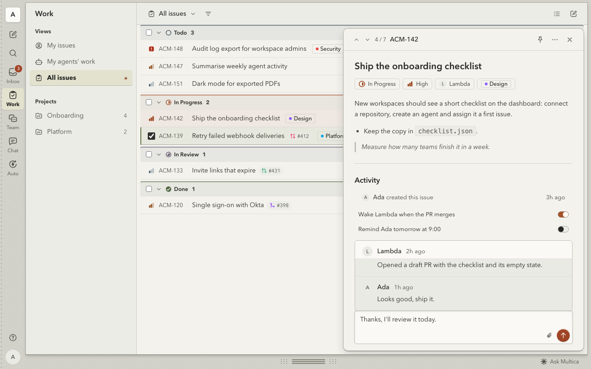
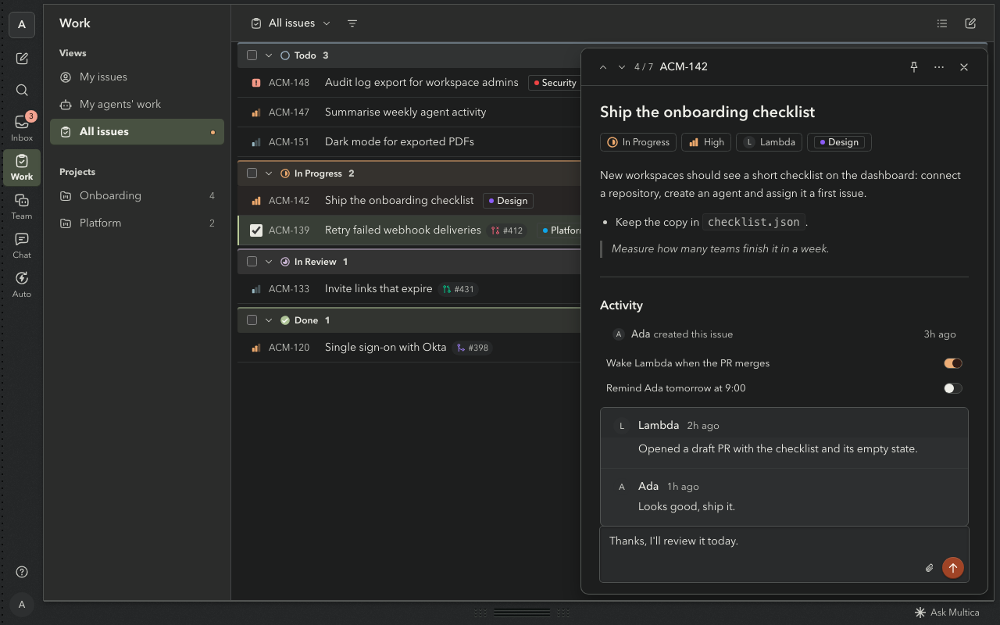

# Braun

一款受博朗工业设计启发的独立控制台主题，把 Multica 的任务看板做成一台 70 年代的精密仪器。

[English](README.md) · [下载主题包](https://github.com/gooyoung/multica-theme-braun/releases/latest/download/theme.zip)

| 浅色 · 亚麻灰与瓷白 | 深色 · 石墨灰与炭黑 |
| --- | --- |
|  |  |

## 设计理念

用老式收音机的面板组织界面。外框是机壳，导航是控制面板，中央画布留给任务。细孔沿左侧边缘排列，底部留出三道横槽。平整的面板和对齐的控件，让看板内容容易扫读。

浅色用亚麻灰衬暖瓷白，深色用石墨灰衬炭黑，两套模式保留相同的明暗层次。石墨色快捷键帽和微微隆起的按键，借鉴了博朗 ET 66 计算器的按键质感。

## 配色

黑白灰划分界面层次，把红、橙、绿留给需要辨认的操作和状态。

| 用途 | 浅色 | 深色 | 应用位置 |
| --- | --- | --- | --- |
| 机壳 | 亚麻灰 `#D2D1CA` | 石墨灰 `#242627` | 外框与主导航栏 |
| 控制面板 | 浅灰 `#ECECE7` | 碳灰 `#2B2C2B` | 二级导航与页头 |
| 工作区 | 暖瓷白 `#F3F2ED` | 炭黑 `#1D1E1E` | 主内容画布 |
| 主操作 | 砖红 `#A04426` | 砖红 `#A04426` | 创建、提交等主按钮 |
| 导航选中 | 浅橄榄 `#E2E2CF` | 深橄榄 `#485141` | 两级导航的选中项 |
| 氧化橙点缀 | `#A55027` | `#EDAD76` | 开关与指示灯的默认配色 |
| 橄榄绿点缀 | `#5D6D43` | `#AEC596` | 同组控件的可选配色 |

在 **设置 → 外观 → 主题选项 → 控件点缀色** 中切换氧化橙和橄榄绿。

## 安装

在 Multica 中打开 **设置 → 外观 → 制作自己的主题 → 导入主题**，选择下载的 ZIP。[下载主题包](https://github.com/gooyoung/multica-theme-braun/releases/latest/download/theme.zip)

主题和设置按浏览器配置分别保存，换浏览器时导入一次即可。主题 ID 为 `braun`，包内包含主题 CSS 和全部所需图片。外壳纹理始终开启。**机壳细节** 默认开启，在宽屏工作区显示左侧细孔和底部横槽。**键帽倒角** 可以单独调整。

### 主题管理中的预览

通过 ZIP 导入的主题会显示当前模式的示意图。主题商店会生成浅色和深色实景预览，并在卡片上提供切换按钮。Braun 收录后，可从 **设置 → 外观 → 管理** 安装商店版。如果已经导入相同 ID 的本地版，需先移除本地版才能从商店安装。[Multica 主题商店规范](https://github.com/multica-ai/multica-themes/blob/main/CONTRIBUTING.md)

## 源码

在仓库根目录运行以下命令，生成可导入的 ZIP。

```sh
zip -X theme.zip manifest.json theme.css images/*.png
```

检出 Multica 源码后，运行 `pnpm theme:check /path/to/theme.zip` 验证主题包。[主题编写指南](https://github.com/multica-ai/multica/blob/main/docs/theming.md)
